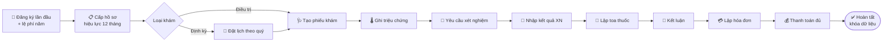
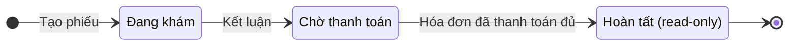
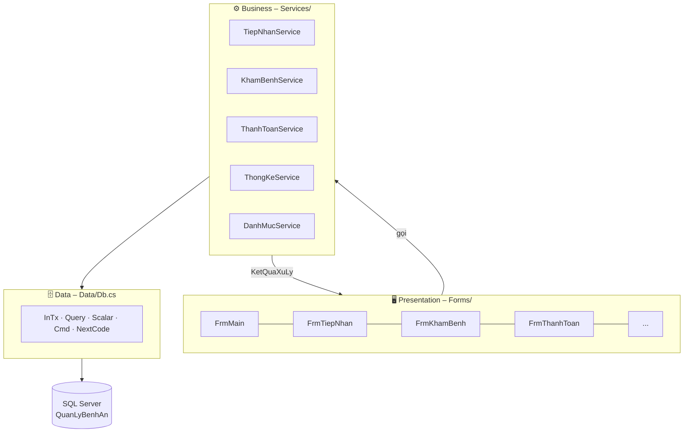
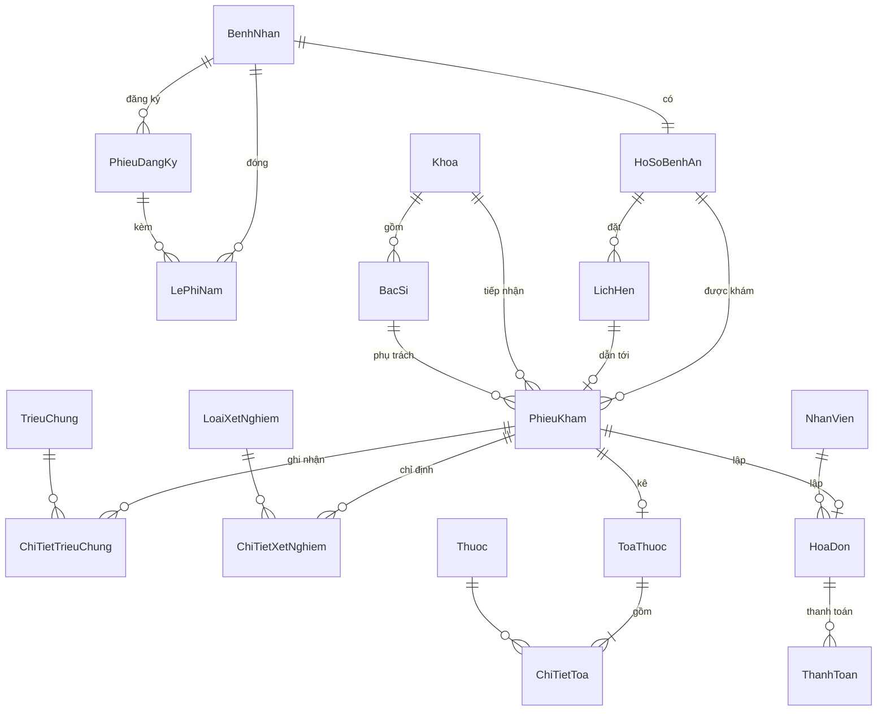

<div align="center">

# 🏥 Quản Lý Hồ Sơ Bệnh Án

**Hệ thống quản lý phòng khám trọn quy trình: tiếp nhận → khám → xét nghiệm → toa thuốc → thanh toán → thống kê**


*Đồ án môn **Phân tích & Thiết kế hướng đối tượng (OOAD)** – Bài 5 · HUTECH*

[Tính năng](#-tính-năng-nổi-bật) · [Kiến trúc](#-kiến-trúc) · [Cài đặt](#-cài-đặt-nhanh) · [CSDL](#-cơ-sở-dữ-liệu) · [Nghiệp vụ](#-quy-tắc-nghiệp-vụ) · [Khắc phục sự cố](#-khắc-phục-sự-cố)

</div>

---

## 📖 Giới thiệu

Ứng dụng desktop **Windows Forms** giúp phòng khám số hóa toàn bộ vòng đời của một lượt khám bệnh: đăng ký hồ sơ lần đầu, thu lệ phí năm, đặt lịch khám định kỳ, khám và ghi nhận triệu chứng, chỉ định xét nghiệm, kê toa, lập hóa đơn, thanh toán đa hình thức và báo cáo thống kê.

Điểm nhấn của dự án là **tính đúng đắn của dữ liệu**: mọi nghiệp vụ chạy trong transaction, có khóa chống xung đột khi nhiều người thao tác cùng lúc, và được bảo vệ thêm một lớp bằng ràng buộc ở tầng cơ sở dữ liệu.

## ✨ Tính năng nổi bật

| Phân hệ | Form | Chức năng chính |
|---|---|---|
| 🗂️ **Danh mục** | `FrmDanhMuc` | Quản lý Khoa, Bác sĩ, Nhân viên, Triệu chứng, Loại xét nghiệm, Thuốc |
| 🧾 **Tiếp nhận** | `FrmTiepNhan` | Đăng ký lần đầu (kèm ảnh bệnh nhân), thu lệ phí năm, gia hạn 12 tháng, tra cứu hồ sơ, xem lịch sử khám |
| 📅 **Lịch hẹn** | `FrmLichHen` | Đặt / hủy lịch khám định kỳ, tối đa 1 lịch mỗi quý |
| 🩺 **Khám bệnh** | `FrmKhamBenh` | Tạo phiếu khám, ghi triệu chứng, yêu cầu xét nghiệm, lập toa thuốc, kết luận |
| 🧪 **Xét nghiệm** | `FrmKetQuaXN` | Kỹ thuật viên nhập kết quả cho các chỉ định đang chờ |
| 💳 **Thanh toán** | `FrmThanhToan` | Lập hóa đơn tự động, thanh toán nhiều lần / nhiều hình thức, hoàn tất và khóa phiếu |
| 📊 **Thống kê** | `FrmThongKe` | Doanh thu, số lượt khám, thuốc đã kê, khối lượng khám theo bác sĩ trong khoảng thời gian tùy chọn |

## 🔄 Quy trình khám bệnh



### Vòng đời của phiếu khám



## 🏗️ Kiến trúc

Dự án tách lớp rõ ràng, form **không chứa SQL** và **không chứa luật nghiệp vụ**:



### Cấu trúc thư mục

```text
QuanLyBenhAn_WinForms/
├── QuanLyBenhAn.sln
├── README.md
└── QuanLyBenhAn/
    ├── App.config                 # Connection string "QuanLyBenhAnDB"
    ├── Program.cs                 # Điểm khởi chạy → FrmMain
    ├── Database/
    │   └── QuanLyBenhAn.sql       # Tạo CSDL + 18 bảng + dữ liệu mẫu
    ├── Data/
    │   └── Db.cs                  # Lớp truy cập dữ liệu dùng chung (ADO.NET)
    ├── Models/
    │   └── ThuocItem.cs           # Dòng thuốc trong toa
    ├── Services/                  # Toàn bộ luật nghiệp vụ
    │   ├── TiepNhanService.cs
    │   ├── KhamBenhService.cs
    │   ├── ThanhToanService.cs
    │   ├── ThongKeService.cs
    │   └── DanhMucService.cs
    └── Forms/                     # Giao diện WinForms (7 form + FrmMain)
```

### Các kỹ thuật đáng chú ý

- **`KetQuaXuLy` (Result pattern)** – service trả về `Ok / Fail + thông báo + dữ liệu`, form chỉ việc hiển thị, không dùng exception để điều khiển luồng.
- **`Db.InTx`** – gói mỗi nghiệp vụ vào một transaction: thành công thì `Commit`, thất bại hoặc có lỗi thì `Rollback`, đồng thời dịch lỗi SQL (trùng khóa, vi phạm khóa ngoại) sang tiếng Việt dễ hiểu.
- **Chống xung đột đồng thời** – dùng `UPDLOCK`, `HOLDLOCK` khi sinh mã và kiểm tra điều kiện, tránh hai người cùng tạo trùng mã hoặc cùng đặt 2 lịch trong một quý.
- **`Db.NextCode`** – sinh mã tăng dần có tiền tố (`BN000001`, `HS000001`, `PK000001`, `HD000001`…).
- **Truy vấn tham số hóa 100%** – không nối chuỗi từ dữ liệu người dùng; tên bảng ở màn danh mục được kiểm tra qua whitelist.
- **Phòng thủ hai lớp** – luật nghiệp vụ kiểm tra ở service, và được CSDL chốt lại bằng `CHECK`, `UNIQUE`, filtered index, computed column.

## 🚀 Cài đặt nhanh

### Yêu cầu

| Thành phần | Phiên bản |
|---|---|
| Hệ điều hành | Windows 10 / 11 |
| IDE | Visual Studio 2022, workload **.NET desktop development** |
| Framework | .NET Framework **4.7.2** |
| CSDL | SQL Server hoặc **LocalDB** (đi kèm Visual Studio) |

### Các bước

**1️⃣ Tạo cơ sở dữ liệu**

Mở **SSMS** (hoặc *SQL Server Object Explorer* trong Visual Studio) và chạy file:

```text
QuanLyBenhAn\Database\QuanLyBenhAn.sql
```

Script tự tạo database `QuanLyBenhAn`, các bảng, chỉ mục và dữ liệu mẫu.

> ⚠️ Script có lệnh `DROP TABLE IF EXISTS`, chạy lại sẽ **xóa sạch dữ liệu cũ**.

**2️⃣ Cấu hình chuỗi kết nối** (bỏ qua nếu dùng LocalDB mặc định)

Mở `QuanLyBenhAn\App.config` và sửa `Data Source` cho khớp máy của bạn:

```xml
<connectionStrings>
  <add name="QuanLyBenhAnDB" providerName="System.Data.SqlClient"
       connectionString="Data Source=(localdb)\MSSQLLocalDB;Initial Catalog=QuanLyBenhAn;Integrated Security=True" />
</connectionStrings>
```

| Môi trường | Giá trị `Data Source` |
|---|---|
| LocalDB (mặc định) | `(localdb)\MSSQLLocalDB` |
| SQL Server Express | `.\SQLEXPRESS` |
| SQL Server đầy đủ | `TENMAY` hoặc `TENMAY\TENINSTANCE` |

Dùng tài khoản SQL thay cho Windows Authentication: thay `Integrated Security=True` bằng `User ID=sa;Password=...`.

**3️⃣ Chạy ứng dụng**

Mở `QuanLyBenhAn.sln` bằng Visual Studio 2022 → nhấn **F5**. Màn hình chính `FrmMain` hiện ra với 7 phân hệ.

## 🧭 Kịch bản chạy thử nhanh (5 phút)

Làm theo đúng thứ tự dưới đây để đi hết một vòng nghiệp vụ:

| # | Form | Thao tác | Kết quả mong đợi |
|:-:|---|---|---|
| 1 | **Tiếp nhận** | Đăng ký bệnh nhân mới, nhập lệ phí năm | Được cấp mã hồ sơ `HS…`, hiệu lực 1 năm |
| 2 | **Khám bệnh** | Tạo phiếu *Điều trị*, ghi triệu chứng, yêu cầu xét nghiệm | Phiếu ở trạng thái *Đang khám* |
| 3 | **Kết quả xét nghiệm** | Chọn chỉ định đang chờ, nhập kết quả | Chỉ định có kết quả và ngày trả |
| 4 | **Khám bệnh** | Lập toa thuốc, nhập kết luận | Phiếu chuyển sang *Chờ thanh toán* |
| 5 | **Thanh toán** | Lập hóa đơn → thanh toán → hoàn tất | Phiếu *Hoàn tất*, dữ liệu bị khóa |
| 6 | **Thống kê** | Chọn khoảng ngày, bấm thống kê | Thấy doanh thu, thuốc đã kê, số ca theo bác sĩ |

💡 Thử thêm: đặt lịch **định kỳ** (khám định kỳ được miễn tiền khám), thanh toán **chia nhiều lần** bằng nhiều hình thức khác nhau.

## 🗄️ Cơ sở dữ liệu

**18 bảng**, chuẩn hóa, ràng buộc chặt chẽ ngay ở tầng CSDL.



<details>
<summary><b>📋 Nhóm bảng và ràng buộc đáng chú ý</b></summary>

<br/>

| Nhóm | Bảng |
|---|---|
| Danh mục | `Khoa`, `BacSi`, `NhanVien`, `TrieuChung`, `LoaiXetNghiem`, `Thuoc` |
| Tiếp nhận | `BenhNhan`, `PhieuDangKy`, `LePhiNam`, `HoSoBenhAn`, `LichHen` |
| Khám bệnh | `PhieuKham`, `ChiTietTrieuChung`, `ChiTietXetNghiem`, `ToaThuoc`, `ChiTietToa` |
| Tài chính | `HoaDon`, `ThanhToan` |

**Ràng buộc do CSDL đảm bảo**

- `BenhNhan` duy nhất theo bộ `(HoTen, NgaySinh, DienThoai)` → không tạo trùng bệnh nhân.
- `HoSoBenhAn.MaBN` là `UNIQUE` → mỗi bệnh nhân chỉ có một hồ sơ.
- `LichHen` có cột tính toán `Quy`, `Nam` (persisted) và **unique index có điều kiện** `(MaHS, Quy, Nam) WHERE TrangThai <> 'Hủy'` → tối đa một lịch/quý.
- `PhieuKham`: khám *Định kỳ* bắt buộc có `MaLich` (`CHECK`), mỗi lịch chỉ dùng cho một phiếu (unique index có điều kiện).
- `ChiTietXetNghiem`: `KetQua` và `NgayTraKQ` phải cùng có hoặc cùng rỗng.
- `ToaThuoc` và `HoaDon` gắn `UNIQUE` với `SoPhieuKham` → mỗi phiếu tối đa một toa, một hóa đơn.
- `HoaDon.TongTien` là cột tính toán `TienKham + TienXetNghiem + TienThuoc` → không thể lệch số.
- Các cột tiền có `CHECK ≥ 0` (hoặc `> 0` với số tiền giao dịch), hình thức thanh toán chỉ nhận 4 giá trị hợp lệ.

</details>

### Dữ liệu mẫu có sẵn

4 nhân viên (CSKH, Thu ngân, KTV xét nghiệm, Quản lý) · 4 khoa · 4 bác sĩ · 5 triệu chứng · 3 loại xét nghiệm · 3 loại thuốc.

> Đơn giá trong dữ liệu mẫu chỉ dùng để minh họa, **không phải bảng giá chính thức**.

## 📏 Quy tắc nghiệp vụ

| Mã | Quy tắc |
|:-:|---|
| **BR01–03** | Đăng ký lần đầu là một giao dịch duy nhất: tạo bệnh nhân + phiếu đăng ký + thu lệ phí năm + cấp hồ sơ. Không cho đăng ký trùng bệnh nhân. |
| **BR02, BR06** | Hồ sơ có hiệu lực **12 tháng**. Gia hạn cộng thêm 12 tháng tính từ ngày hết hạn (hoặc từ hôm nay nếu đã hết hạn). Hồ sơ hết hạn thì **không được khám**. |
| **BR04** | Mỗi lượt khám tạo một phiếu khám riêng, gồm loại khám *Điều trị* hoặc *Định kỳ*. |
| **BR05** | Mỗi loại xét nghiệm chỉ chỉ định **một lần** trên mỗi phiếu. Mỗi phiếu chỉ có **một toa thuốc**. |
| **BR07** | Tra cứu hồ sơ theo mã hồ sơ, số điện thoại, họ tên hoặc ngày sinh. |
| **BR08** | Mỗi hồ sơ chỉ được **một lịch khám định kỳ mỗi quý**. Ngày hẹn phải ở tương lai và không vượt hạn hồ sơ. |
| **BR09** | Bác sĩ phải thuộc đúng khoa đã chọn. Khám định kỳ phải dùng lịch hẹn *Đã đặt* của chính hồ sơ đó trong quý hiện tại. |
| **BR10** | Chỉ **bác sĩ phụ trách** phiếu mới được lập toa. Toa phải có ít nhất 1 thuốc, không lặp thuốc, số lượng > 0. |
| **BR11** | Hóa đơn = tiền khám + tiền xét nghiệm + tiền thuốc. **Khám định kỳ miễn tiền khám.** Chỉ lập hóa đơn khi mọi xét nghiệm đã có kết quả. Hóa đơn 0đ tự động ghi nhận đã thanh toán. Chỉ *Hoàn tất* khi hóa đơn đã trả đủ, sau đó phiếu bị khóa. |
| **BR12** | Một hóa đơn có thể trả **nhiều lần, nhiều hình thức** (tiền mặt, chuyển khoản, thẻ, ví điện tử), tổng không được vượt số tiền phải trả. |

Ngoài ra: phiếu điều trị phải ghi **ít nhất một triệu chứng** trước khi kết luận; phiếu đã *Hoàn tất* không thể chỉnh sửa.

## 🛠️ Công nghệ sử dụng

| Lớp | Công nghệ |
|---|---|
| Giao diện | Windows Forms (.NET Framework 4.7.2) |
| Ngôn ngữ | C# |
| Truy cập dữ liệu | ADO.NET thuần (`SqlConnection`, `SqlCommand`, `SqlDataAdapter`) |
| Cơ sở dữ liệu | Microsoft SQL Server / LocalDB (T-SQL) |
| Cấu hình | `App.config` + `System.Configuration` |
| Build | Visual Studio 2022 (MSBuild) |

## 🧯 Khắc phục sự cố

<details>
<summary><b>❌ <code>NullReferenceException</code> tại <code>Db.CS</code> (ConnectionStrings["QuanLyBenhAnDB"] returned null)</b></summary>

<br/>

Chương trình không tìm thấy chuỗi kết nối lúc chạy. Kiểm tra:

1. Tên trong `App.config` phải khớp **chính xác** `QuanLyBenhAnDB` (phân biệt chữ hoa/thường).
2. Thẻ `<connectionStrings>` nằm trực tiếp trong `<configuration>`.
3. `QuanLyBenhAn` đang là **Startup Project** (chuột phải project → *Set as Startup Project*).
4. File `bin\Debug\QuanLyBenhAn.exe.config` có chứa chuỗi kết nối. Nếu không, hãy *Rebuild Solution*.

</details>

<details>
<summary><b>❌ <code>Cannot open database "QuanLyBenhAn"</code> / lỗi 4060</b></summary>

<br/>

Chưa chạy script tạo CSDL, hoặc `Data Source` đang trỏ sai máy chủ. Chạy lại `Database\QuanLyBenhAn.sql` trên **đúng** instance mà `App.config` đang dùng.

</details>

<details>
<summary><b>❌ <code>A network-related or instance-specific error</code> / không kết nối được máy chủ</b></summary>

<br/>

- Kiểm tra dịch vụ SQL Server đã chạy (*SQL Server Configuration Manager* hoặc `services.msc`).
- Với LocalDB, thử khởi động bằng lệnh: `sqllocaldb start MSSQLLocalDB`.
- Kiểm tra lại tên instance trong `Data Source`.

</details>

<details>
<summary><b>❌ Không có LocalDB trên máy</b></summary>

<br/>

Cài thêm thành phần *SQL Server Express LocalDB* trong Visual Studio Installer (tab *Individual components*), hoặc đổi `Data Source` sang SQL Server Express đã cài sẵn (`.\SQLEXPRESS`).

</details>

## 🗺️ Hướng phát triển

- [ ] Đăng nhập và phân quyền theo vai trò (CSKH, Thu ngân, KTV, Quản lý, Bác sĩ)
- [ ] In toa thuốc, hóa đơn và phiếu kết quả xét nghiệm (PDF)
- [ ] Biểu đồ trực quan cho màn hình thống kê
- [ ] Quản lý tồn kho thuốc và cảnh báo chống chỉ định khi kê toa
- [ ] Nhắc lịch hẹn qua SMS / email
- [ ] Unit test cho tầng `Services`

## 📄 Giấy phép & Tác giả

Dự án phục vụ mục đích **học tập** trong khuôn khổ môn OOAD – HUTECH.

<!-- Thay thông tin bên dưới bằng thông tin của nhóm/bạn -->
**Nhóm thực hiện:** _Họ tên – MSSV_ · **Giảng viên hướng dẫn:** _Tên giảng viên_

---

<div align="center">

⭐ Nếu thấy dự án hữu ích, hãy để lại một ngôi sao nhé!

</div>
